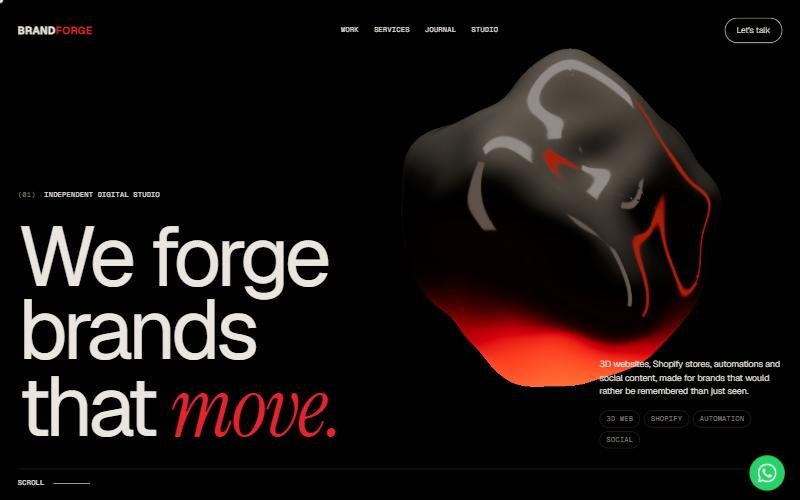
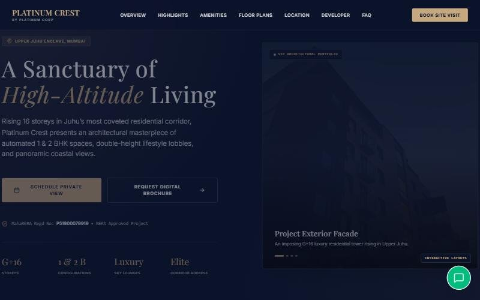
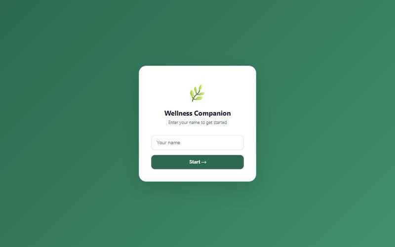
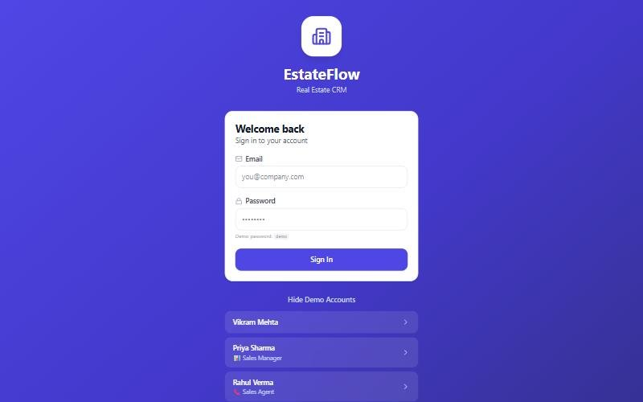
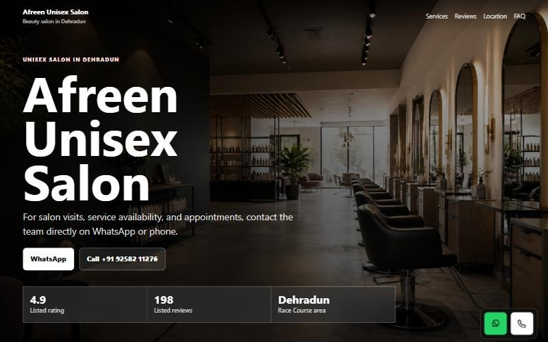
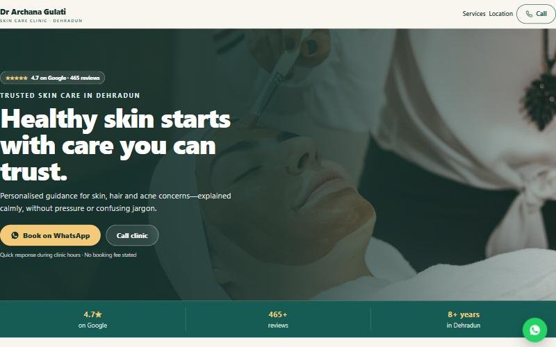

<div align="center">


</div>

```console
$ whoami
ayush bhatt · full-stack dev @ brandforge media · dehradun, in

$ cat now.txt
→ the BrandForge Media site: real-time 3D with Three.js + GSAP
→ OnlyRandoms: an Android app on a Firebase backend
→ local-first AI agents: a wellness coach with memory and crisis detection
```

<div align="center">
  
</div>

### shipped

<table>
  <tr>
    <td colspan="2" align="center">
      <a href="https://brandforge-media.vercel.app"></a>
      <br />
      <b><a href="https://brandforge-media.vercel.app">BrandForge Media</a></b> · <a href="https://github.com/baerozgaarmard/brandforge-media">code</a>
      <br />
      <sub>Our studio site: real-time 3D, scroll-driven motion and 33 search-ready pages · Vite · Three.js · GSAP</sub>
    </td>
  </tr>
  <tr>
    <td width="50%" valign="top">
      <a href="https://invitations-xi.vercel.app"></a>
      <br />
      <b><a href="https://invitations-xi.vercel.app">Manas &amp; Anchal</a></b> · <a href="https://github.com/baerozgaarmard/manas-anchal-wedding-invitation">code</a>
      <br />
      <sub>Interactive, illustrated wedding invitation, made for phones · React · Framer Motion</sub>
    </td>
    <td width="50%" valign="top">
      <a href="https://platinum-corp-demo.vercel.app"></a>
      <br />
      <b><a href="https://platinum-corp-demo.vercel.app">Platinum Crest</a></b> · <a href="https://github.com/baerozgaarmard/platinum-corp-demo">code</a>
      <br />
      <sub>Luxury real-estate landing page for a Mumbai tower · React · Tailwind · Google Maps</sub>
    </td>
  </tr>
  <tr>
    <td width="50%" valign="top">
      <a href="https://ai-agent-final-reet.onrender.com"></a>
      <br />
      <b><a href="https://ai-agent-final-reet.onrender.com">Wellness Companion AI</a></b> · <a href="https://github.com/baerozgaarmard/Ai-Agent-Final">code</a>
      <br />
      <sub>AI coach with memory and safety-first crisis detection · FastAPI · Groq</sub>
    </td>
    <td width="50%" valign="top">
      <a href="https://demo-crm-nu.vercel.app"></a>
      <br />
      <b><a href="https://demo-crm-nu.vercel.app">EstateFlow CRM</a></b> · <a href="https://github.com/baerozgaarmard/demo-crm">code</a>
      <br />
      <sub>Mobile-first real-estate CRM: leads, one-tap calls, follow-ups · React · Zustand</sub>
    </td>
  </tr>
  <tr>
    <td width="50%" valign="top">
      <a href="https://salon-demo-website-ten.vercel.app"></a>
      <br />
      <b><a href="https://salon-demo-website-ten.vercel.app">Afreen Unisex Salon</a></b> · <a href="https://github.com/baerozgaarmard/Salon-Demo-website">code</a>
      <br />
      <sub>Fast, accessible landing page for a Dehradun salon · HTML · JSON-LD</sub>
    </td>
    <td width="50%" valign="top">
      <a href="https://demo-websites-umber.vercel.app"></a>
      <br />
      <b><a href="https://demo-websites-umber.vercel.app">Skin clinic site</a></b> · <a href="https://github.com/baerozgaarmard/demo-websites">code</a>
      <br />
      <sub>Mobile-first site for a Dehradun dermatology clinic · HTML</sub>
    </td>
  </tr>
</table>

<picture>
  <source media="(prefers-color-scheme: dark)" srcset="https://raw.githubusercontent.com/baerozgaarmard/baerozgaarmard/output/snake-dark.svg" />
  
</picture>

<div align="center">

<a href="https://www.instagram.com/baerozgaarmard"></a>
<a href="https://www.linkedin.com/in/brandforge-media"></a>
<a href="https://x.com/baerozgaarmard"></a>


**[brandforge-media.vercel.app](https://brandforge-media.vercel.app)** — the studio I build for


</div>
