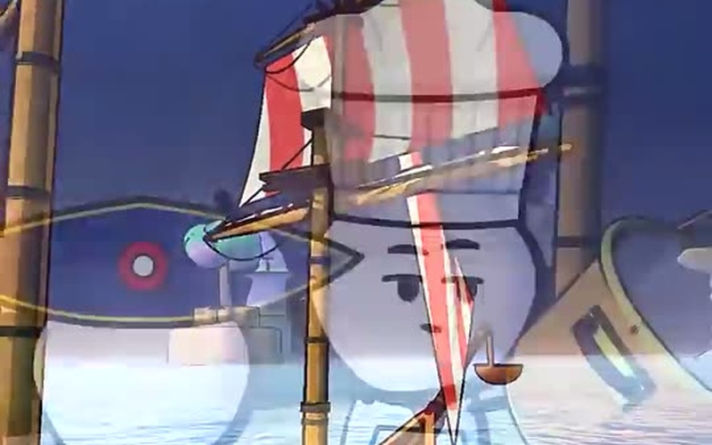

<div align="center">

<!-- Header banner (inspired by mayhemantt & MartinHeinz) -->


<!-- Animated typing subtitle (inspired by zumrudu-anka & salesp07) -->
<a href="https://git.io/typing-svg">
  
</a>

<br />

<!-- Live GitHub meta-badges (inspired by milaan9 & Spiderpig86) -->
<p align="center">
  
  <a href="https://github.com/baerozgaarmard?tab=followers"></a>
  <a href="https://github.com/baerozgaarmard/baerozgaarmard"></a>
</p>

<!-- Tagline motto (inspired by mayhemantt) -->
<h5><i>⚡️ Fast prototypes, production-grade craft, zero boilerplate. The best code is the code that ships. ⚡️</i></h5>

</div>

---

<!-- Right-aligned Focus Matrix + Console intro (inspired by milaan9 & sciencepal) -->
<table align="right">
  <tr><th colspan="2" align="left">🧭 Core Focus</th></tr>
  <tr><td>AI Agents &amp; RAG</td><td><code>★★★★★</code></td></tr>
  <tr><td>TypeScript / React</td><td><code>★★★★★</code></td></tr>
  <tr><td>Three.js &amp; WebGL</td><td><code>★★★★☆</code></td></tr>
  <tr><td>Python / FastAPI</td><td><code>★★★★☆</code></td></tr>
  <tr><td>DSP &amp; Video Gen</td><td><code>★★★★☆</code></td></tr>
</table>

### `whoami`

Hi, I'm **Ayush Bhatt** (`@baerozgaarmard`) — an independent **creative engineer and full-stack developer** based in Dehradun, India. I build autonomous AI agent pipelines, procedural 3D graphics, and crisp web applications from zero to production.

```console
$ whoami
ayush bhatt · independent creative engineer · dehradun, uttarakhand, in

$ cat now.txt
→ ultimate-faceless-shorts-pipeline : code-native video studio with local TTS & Whisper
→ animated-shorts-skill             : 3D toon storytelling via Three.js + Remotion + DSP
→ tube-trek                         : agent-native YouTube Shorts studio (zero API keys)
→ ai-bot-city-simulator             : living isometric town driven by autonomous agents
```

<br clear="both" />

---

### 🛠 Tech Stack & Tools

<!-- Dual-row centered skillicons grid (inspired by salesp07 & AVS1508) -->
<div align="center">
  
  <br />
  
</div>

---

### 📌 Pinned Work

<!-- Flagship pinned web build (assets/brandforge.jpg) + 2-column repo pins (inspired by MartinHeinz & zumrudu-anka) -->
<table>
  <tr>
    <td colspan="2" align="center">
      <a href="https://brandforge-media.vercel.app"></a>
      <br />
      <b><a href="https://brandforge-media.vercel.app">BrandForge Media Website</a></b> · <a href="https://github.com/baerozgaarmard/brandforge-media">source code</a>
      <br />
      <sub>Interactive 3D web experience built with real-time WebGL, scroll-driven motion, and 33 search-ready static pages · Vite · Three.js · GSAP</sub>
    </td>
  </tr>
</table>

<div align="center">
  <a href="https://github.com/baerozgaarmard/ultimate-faceless-shorts-pipeline">
    
  </a>
  <a href="https://github.com/baerozgaarmard/animated-shorts-skill">
    
  </a>
  <br />
  <a href="https://github.com/baerozgaarmard/tube-trek">
    
  </a>
  <a href="https://github.com/baerozgaarmard/ai-bot-city-simulator">
    
  </a>
</div>

---

### 🎨 Featured Builds

<!-- Visual preview grid + AI/systems engineering cards (inspired by midudev) -->
<table>
  <tr>
    <td width="50%" valign="top">
      <a href="https://github.com/baerozgaarmard/animated-shorts-skill"></a>
      <br />
      <b><a href="https://github.com/baerozgaarmard/animated-shorts-skill">Animated Shorts Studio</a></b> · <a href="https://github.com/baerozgaarmard/animated-shorts-skill">code</a>
      <br />
      <sub>Autonomous 3D toon storytelling pipeline: 2D bean-head actors inside a painted 3D world · Three.js · Remotion · Python DSP</sub>
    </td>
    <td width="50%" valign="top">
      <a href="https://invitations-xi.vercel.app"></a>
      <br />
      <b><a href="https://invitations-xi.vercel.app">Manas &amp; Anchal</a></b> · <a href="https://github.com/baerozgaarmard/manas-anchal-wedding-invitation">code</a>
      <br />
      <sub>Interactive illustrated invitation crafted for mobile screens · React · Framer Motion</sub>
    </td>
  </tr>
  <tr>
    <td width="50%" valign="top">
      <b><a href="https://github.com/baerozgaarmard/enterprise-rag-chiller-manuals">Enterprise RAG — Chiller Manuals</a></b> · <a href="https://github.com/baerozgaarmard/enterprise-rag-chiller-manuals">code</a>
      <br />
      <sub>Grounded technical Q&amp;A over industrial chiller manuals with document, page, and chunk-level citations plus insufficient-evidence refusal · Python · RAG</sub>
    </td>
    <td width="50%" valign="top">
      <b><a href="https://github.com/baerozgaarmard/document-intelligence-ocr-pipeline">Document Intelligence OCR</a></b> · <a href="https://github.com/baerozgaarmard/document-intelligence-ocr-pipeline">code</a>
      <br />
      <sub>Hybrid PyMuPDF &amp; OCR pipeline preserving layout, headings, tables, and normalized bounding boxes in versioned JSON · Python · OCR</sub>
    </td>
  </tr>
  <tr>
    <td width="50%" valign="top">
      <b><a href="https://github.com/baerozgaarmard/autonomous-lfq-pricing-agent">Autonomous LFQ Pricing Agent</a></b> · <a href="https://github.com/baerozgaarmard/autonomous-lfq-pricing-agent">code</a>
      <br />
      <sub>Explainable pricing-research agent evaluating catalog cost baselines, competitor signals, and policy constraints with human-in-the-loop approval · Python · Agents</sub>
    </td>
    <td width="50%" valign="top">
      <b><a href="https://github.com/baerozgaarmard/Stela-Mac-Os">Stela (Apple Silicon on x86-64)</a></b> · <a href="https://github.com/baerozgaarmard/Stela-Mac-Os">code</a>
      <br />
      <sub>Experimental UEFI translation layer with an arm64-to-x86-64 translator and NVIDIA GPU Metal driver work · Rust</sub>
    </td>
  </tr>
</table>

<!-- Collapsible drawers for setup & additional builds (inspired by iampavangandhi & Spiderpig86) -->
<details>
  <summary><b>🗂️ Additional Builds</b> <i>(click to expand)</i></summary>
  <br />

| Project | Focus | Link |
| :--- | :--- | :--- |
| **BrandForge POS** | Offline-first restaurant POS and order management system | [Repo](https://github.com/baerozgaarmard/brandforge-pos) |
| **Afreen Unisex Salon** | Accessible fast local-business landing page | [Repo](https://github.com/baerozgaarmard/Salon-Demo-website) |

</details>

<details>
  <summary><b>⚙️ Environment &amp; Workflow</b> <i>(click to expand)</i></summary>
  <br />
  <ul>
    <li><b>OS:</b> Windows 11 + WSL2 / Linux</li>
    <li><b>Stack:</b> TypeScript, React, Next.js, Three.js, Remotion, Python (FastAPI, DSP, Whisper)</li>
    <li><b>Philosophy:</b> Minimal code, standard primitives first, zero unrequested abstractions</li>
    <li><b>Current Obsession:</b> Agent-native procedural video &amp; 3D storytelling engines</li>
  </ul>
</details>

---

### 📊 Engineering Telemetry & Contribution Snake

<div align="center">
  
  
</div>

<br />

<div align="center">
  
</div>

<br />

<!-- Activity Graph (inspired by zumrudu-anka) -->
<div align="center">
  
</div>

<br />

<!-- Dark/light contribution snake (inspired by salesp07) -->
<div align="center">
  <picture>
    <source media="(prefers-color-scheme: dark)" srcset="https://raw.githubusercontent.com/baerozgaarmard/baerozgaarmard/output/snake-dark.svg" />
    
  </picture>
</div>

<br />

<!-- Random Dev Quote (inspired by iampavangandhi) -->
<div align="center">
  
</div>

---

### 🤝 Collaborate & Connect

I work directly with founders, product teams, and engineers to ship custom web apps, interactive 3D experiences, and autonomous AI workflows — fast turnarounds, zero middle layers.

<div align="center">

<a href="https://www.linkedin.com/in/ayushbhatt207"></a>
<a href="mailto:ayushbhatt207@gmail.com"></a>
<a href="https://wa.me/919311267085"></a>
<a href="https://x.com/baerozgaarmard"></a>
<a href="https://www.instagram.com/baerozgaarmard"></a>


<br /><br />


</div>
